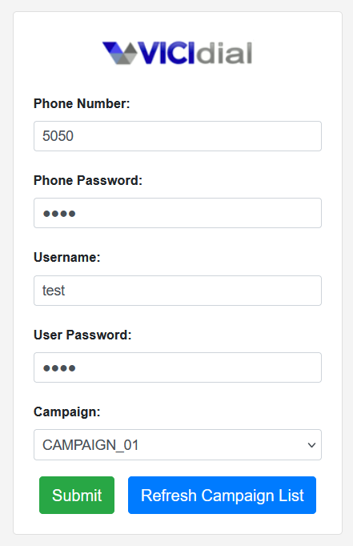
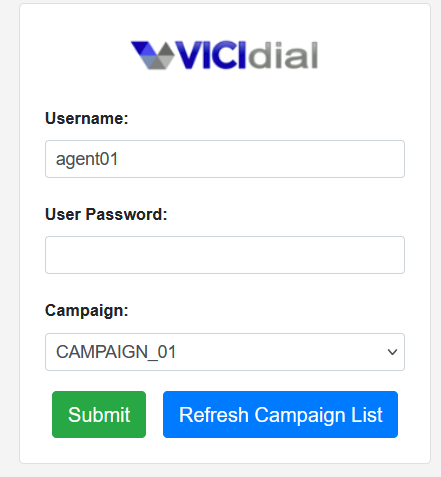
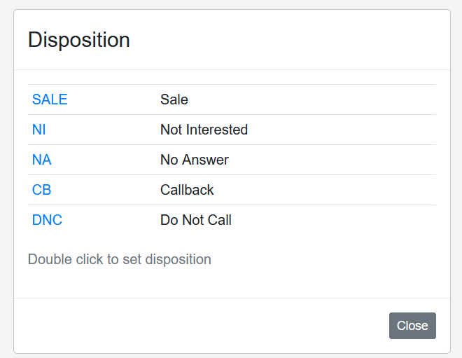

# vici-agent-theme

This is a vicidial agent theme to apply a new design to vicidial.

## How to setup

Download with git and cd to your vicidial root dir:

```bash
git clone git@github.com:cesarvargas289/vici-agent-theme.git
```

Then go to your browser: `vici-agent-theme/vicidial.php`

### It's done, enjoy!

---

## Changelog

### v1.1 - English language & i18n support
- Translated all hardcoded Spanish strings to English
- All UI texts now go through `_QXZ()` — Vicidial's built-in translation function
- English is now the default fallback language — if no translation is found, the English text is shown

---

## Adding a new language

This theme uses Vicidial's built-in translation system (`_QXZ()`). All UI texts are stored in English as the key, and translated on the fly based on the user's selected language.

To add a new language, insert translation records into the `vicidial_language_phrases` table. The `language_id` must match a language registered in the `vicidial_languages` table.

### Example: Spanish (`es`)

```sql
INSERT INTO vicidial_language_phrases (english_text, translated_text, language_id)
VALUES
  ('Campaign:', 'Campaña:', 'es'),
  ('Username:', 'Nombre de Usuario:', 'es'),
  ('User Password:', 'Contraseña:', 'es'),
  ('Phone Number:', 'Número de Teléfono:', 'es'),
  ('Select a Campaign', 'Seleccione una Campaña', 'es'),
  ('Refresh Campaign List', 'Actualizar Lista de Campañas', 'es'),
  ('Customer Information:', 'Información del cliente:', 'es'),
  ('Dial Next Number', 'Marcar Siguiente Número', 'es'),
  ('Show Next Number', 'Mostrar Siguiente Número', 'es'),
  ('Consultative Call', 'Llamada de consulta', 'es'),
  ('End consultative call', 'Terminar llamada de consulta', 'es'),
  ('Disposition', 'Tipificación', 'es'),
  ('Log Out', 'Cerrar Sesión', 'es'),
  ('Submit', 'Enviar', 'es'),
  ('Your session has been disabled', 'Tu sesión ha sido deshabilitada', 'es'),
  ('CLICK HERE TO RESTART THE SESSION', 'CLICK AQUÍ PARA REINICIAR LA SESIÓN', 'es');
```

### Example: Portuguese (`pt`)

```sql
INSERT INTO vicidial_language_phrases (english_text, translated_text, language_id)
VALUES
  ('Campaign:', 'Campanha:', 'pt'),
  ('Username:', 'Nome de Usuário:', 'pt'),
  ('User Password:', 'Senha:', 'pt'),
  ('Phone Number:', 'Número de Telefone:', 'pt'),
  ('Select a Campaign', 'Selecione uma Campanha', 'pt'),
  ('Refresh Campaign List', 'Atualizar Lista de Campanhas', 'pt'),
  ('Customer Information:', 'Informações do Cliente:', 'pt'),
  ('Dial Next Number', 'Discar Próximo Número', 'pt'),
  ('Show Next Number', 'Mostrar Próximo Número', 'pt'),
  ('Consultative Call', 'Chamada Consultiva', 'pt'),
  ('End consultative call', 'Encerrar chamada consultiva', 'pt'),
  ('Disposition', 'Disposição', 'pt'),
  ('Log Out', 'Sair', 'pt'),
  ('Submit', 'Enviar', 'pt');
```

> To add any other language, follow the same pattern using the corresponding `language_id` (e.g. `fr` for French, `de` for German, `it` for Italian).

---

## Screenshots

### Login


### Re-login


### Logged in


### Transfer / Conference


### Disposition


### Session Disabled


---

### Still working on it!!
